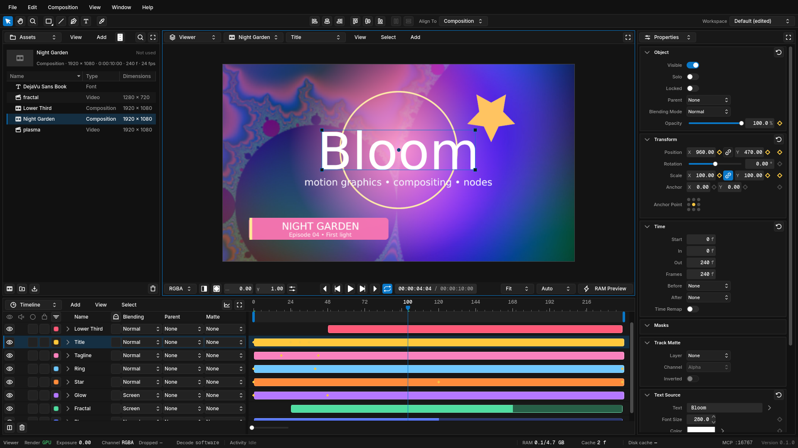
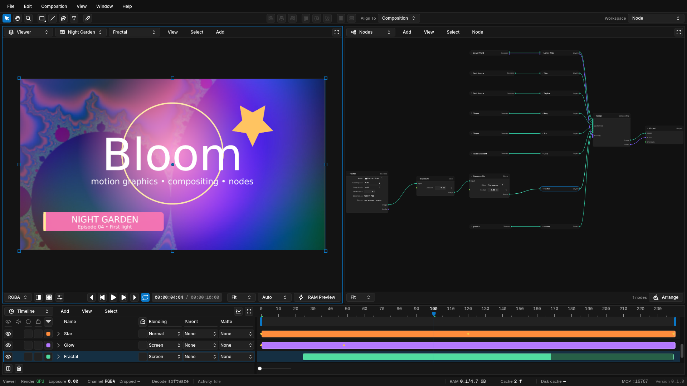
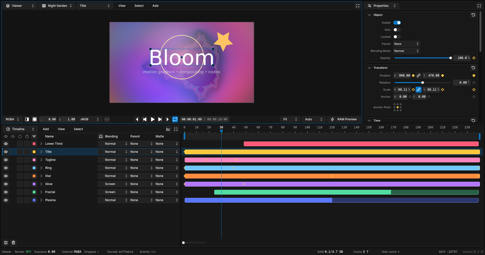
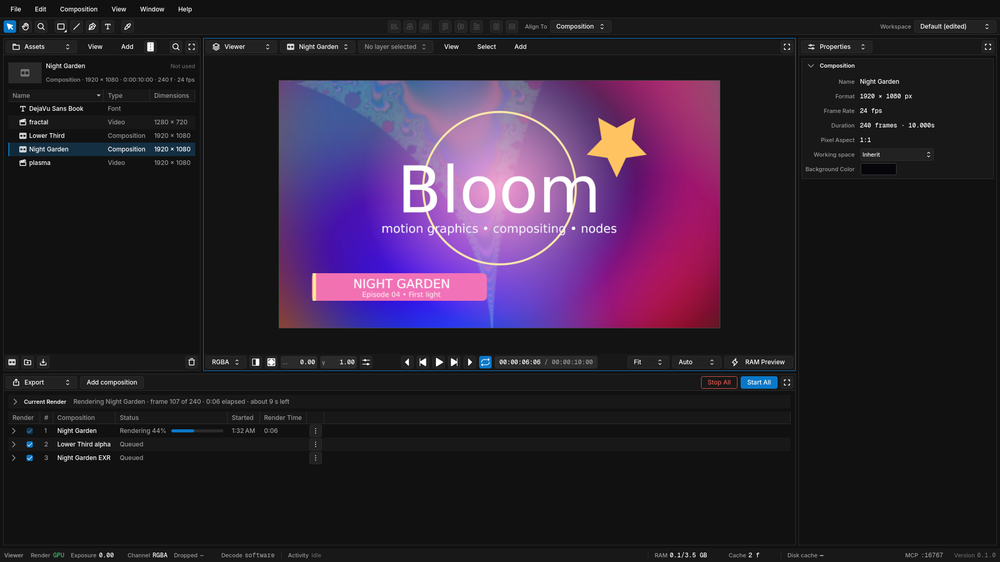

# Bloom

**Motion graphics and compositing, where the layer timeline and the node graph are the same
composition.**

[](LICENSE)




Bloom is an open-source desktop app for motion graphics and visual effects. If you've used a
layer-based compositor, you'll feel at home: layers on a timeline, keyframes, precomps, masks,
track mattes and a render queue. Underneath, every composition is also a node graph. Open the Nodes panel and
you're looking at the same shot, not a copy of it. Change either one and the other follows.

Bloom is written in C++20 and Qt 6. On Linux, macOS and Windows, the Viewer and final renders run
on the GPU through Vulkan (MoltenVK on macOS). A CPU reference renderer defines what every frame should look like, so the GPU can't
quietly change your picture.

> [!IMPORTANT]
> Bloom is pre-release software. There are no downloadable builds yet (installers for the first
> alpha are planned in #734), so you build it from source. Day-to-day development and testing
> happen on Linux, and macOS and Windows builds are supported.

## A look around

Every image here is a real Bloom session, captured from the `main` branch. The project uses
generated footage plus Bloom's own shapes, gradients and text.

**Node workspace.** The same composition as a graph. The fractal footage runs through Exposure and
Gaussian Blur before it joins the other layers in one Merge.



**Animation workspace.** The Viewer and Properties over a tall Timeline, with every layer and its
keyframes in view.



**Rendering in the background.** The Export queue takes the Timeline's place, renders one job at a
time and tells you how long is left. You can keep working while it runs.



## Build from source

There are two ways to build, and they need different things.

- **Qualified** (the reproducible build, required on Linux): every library Bloom uses, including Qt,
  comes from a dependency prefix that you build once from a reviewed lock file. This is the build
  that is validated on Linux, macOS and Windows.
- **`dev`** (macOS and Windows only): uses the libraries installed on your system. It is labeled
  Unqualified: your library versions may differ from the locked ones, and the build cannot produce
  a release package.

### Linux

The `dev` preset does not work on Linux: the media worker requires the locked FFmpeg from the
dependency prefix. Build the prefix first, then Bloom.

You need Clang 22 (the qualified build checks the compiler against the lock), CMake 3.25 or newer,
Ninja, Meson, Python 3, `patchelf` and the Fontconfig development files. The superbuild downloads
every locked archive, checks its SHA-256 and builds it into the prefix; build it again after the
lock changes.

```sh
cmake -S dependencies/superbuild -B build/dependency-superbuild \
    -DBLOOM_DEPENDENCY_PREFIX="$PWD/build/dependency-prefix" \
    -DCMAKE_C_COMPILER=clang -DCMAKE_CXX_COMPILER=clang++
cmake --build build/dependency-superbuild

CC=clang CXX=clang++ cmake --preset desktop-release
cmake --build --preset desktop-release
ctest --preset desktop-release
```

The app is written to `build/desktop-release/apps/bloom/Bloom`. The `ci-linux-native` preset builds
the same thing without the desktop app.

### macOS and Windows with the `dev` preset

You need a C++20 compiler, CMake 3.25 or newer, Ninja, and these packages, each findable by CMake as
a package (`find_package`):

- Qt 6.8 or newer: Widgets, Network, Svg, and Test for the tests
- OpenColorIO, OpenEXR with Imath, libzip, zlib and yyjson

Optional, with what you lose without them:

- FFmpeg: without it there is no FFmpeg media worker, and media goes through the operating system's
  decoders only.
- Vulkan Headers and Vulkan Memory Allocator (as CMake packages): without them Bloom builds a
  CPU-only stand-in for the GPU device, so the Viewer and renders use the CPU reference path.
  Bloom never reports GPU rendering in such a build.
- `glslangValidator` and `spirv-val`: without them the checked-in shaders are used as they are
  (their pinned digests are still checked); they are only needed to regenerate shaders.
- CPython 3.10 or newer with its development files, and nanobind: on Windows the Python scripting
  bridge is built when they are found. A macOS `dev` build leaves Python off.

```sh
cmake --preset dev
cmake --build --preset dev
ctest --preset dev
```

Tests that need a GPU device are skipped on a machine or build without one. For the qualified build
on macOS and Windows (Apple Clang, or MSVC with MSYS2 for the codec libraries), see
[`docs/architecture/dependency-intake.md`](docs/architecture/dependency-intake.md).

## Documentation

- [User guides](docs/README.md#user-guides): the Viewer, keyframes and easing, workspaces,
  exporting, color management, Python, `bloom-cli` and MCP.
- [Documentation index](docs/README.md): Bloom's canonical docs, in reading order.
- [Product foundation](docs/product/foundation.md): what Bloom is, and the decisions behind it.
- [Architecture overview](docs/architecture/overview.md) and
  [decision records](docs/decisions/): how the code is organized, and why.
- [Roadmap](docs/roadmap.md) and [node catalogue](docs/product/node-catalogue.md): the long-term
  plan.

## Contributing

The docs in this repository are Bloom's source of truth. Before you propose a change, read the
[documentation index](docs/README.md), the [product foundation](docs/product/foundation.md), and
the architecture or UX document that owns the behavior you want to change. Changes to module
boundaries or saved project semantics should update that document too, with an
[ADR](docs/decisions/) when they cut across the codebase.

Keep contributions small and vertical, with tests for document, command, project I/O and rendering
behavior. UI code reads state and issues commands. It never owns project data or does heavy work
on the UI thread.

## License

Bloom's original source and documentation are licensed under the
[Apache License, Version 2.0](LICENSE). Third-party dependencies and assets keep their own
licenses. Distributed builds must include the corresponding notices, source information and other
obligations of the components they ship.
