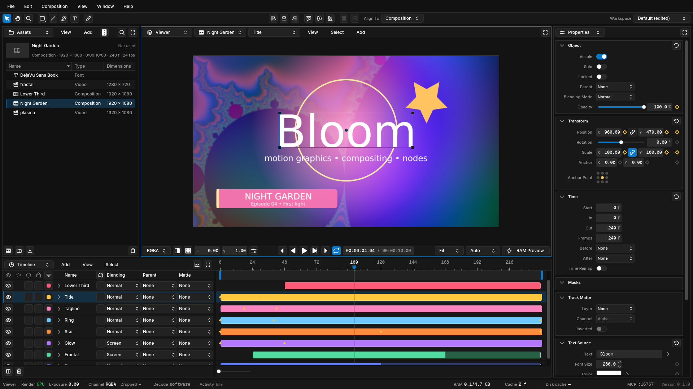
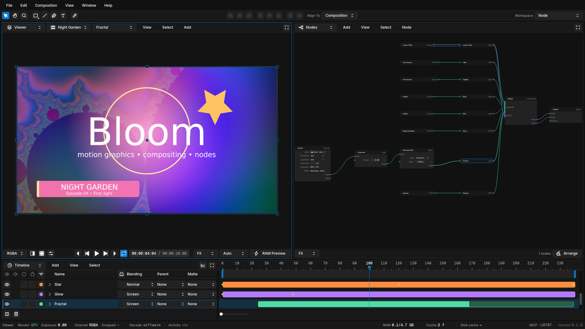
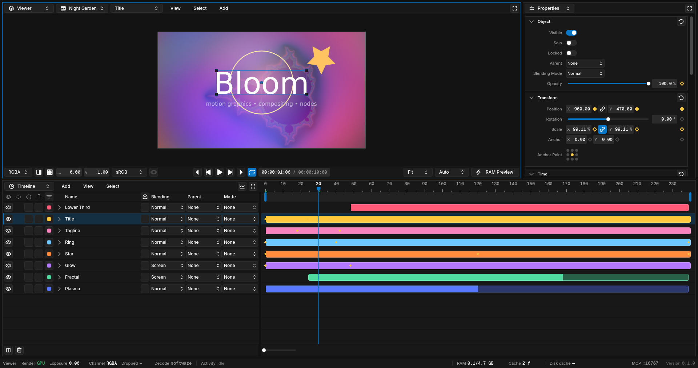
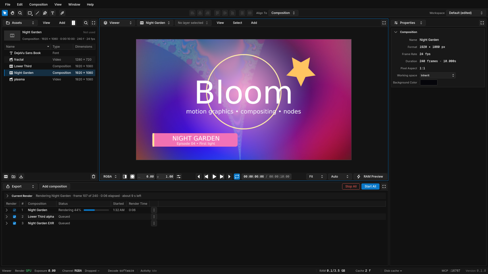

# Bloom

**Motion graphics and compositing, where the layer timeline and the node graph are the same
composition.**

[](LICENSE)




Bloom is an open-source desktop app for motion graphics and visual effects. If you've worked in
After Effects, you'll feel at home: layers on a timeline, keyframes, precomps, masks, track mattes
and a render queue. Underneath, every composition is also a node graph. Open the Nodes panel and
you're looking at the same shot, not a copy of it. Change either one and the other follows.

Bloom is written in C++20 and Qt 6. On Linux, the Viewer and final renders run on the GPU through
Vulkan. A CPU reference renderer defines what every frame should look like, so the GPU can't
quietly change your picture.

> [!IMPORTANT]
> Bloom is pre-release software. There are no downloadable builds yet, so you build it from source,
> and day-to-day development and testing happen on Linux. See [Project status](#project-status).

## A look around

Every image here is a real Bloom session, captured from the `main` branch. The project uses
generated footage plus Bloom's own shapes, gradients and text.

**Node workspace.** The same composition as a graph. The fractal footage runs through Exposure and
Gaussian Blur before it joins the other layers in one Merge.



**Animation workspace.** The Viewer and Properties over a tall Timeline, with every layer and its
keyframes in view.



**Rendering in the background.** The Export queue takes the Timeline's place, renders one job at a
time and tells you how long is left. You can keep working while it runs.



**The result.** The first six seconds of that export, scaled down from the H.264 file the queue
wrote.


## What works today

**Build a shot**

- Video, image sequences, audio, text, shapes, solids and nested compositions as layers, plus
  gradient and checker generators in the node graph.
- Parenting, track mattes, masks, blend modes, shy, solo, lock and time remapping.
- Move, scale and rotate layers right in the Viewer. Draw shapes, paths and masks with the Pen.

**Animate**

- Keyframe any property and shape the motion in the Graph Editor, with value and speed graphs.
- Easy Ease, plus Blender's easing curves, from Sine through Elastic.
- Undo and redo for every edit, whether it came from a panel, a script or an agent.

**Work in nodes**

- Gaussian and box blur, exposure, offset, multiply, invert, crop, pad, flip, quarter-turn rotate,
  resize and fit, image mix, alpha and channel operations, Cryptomatte, and OpenColorIO transforms
  and LUTs.
- Drive parameters from value and math nodes.

**See it**

- A GPU Viewer with RAM Preview, channel and alpha views, and exposure control.
- OpenColorIO color management with a scene-linear working space. New projects use Bloom Neutral,
  and the ACES 1.3 CG configuration is built in.

**Deliver it**

- H.264, HEVC, AV1, VP9, ProRes and DNxHR movies; OpenEXR, PNG and TIFF sequences; WAV audio.
- Projects save as `.bloom` files, written atomically and validated when they open.

**Automate it**

- Script Bloom in Python, render headlessly with `bloom-cli`, or let an AI agent work in the open
  app through the built-in [MCP](https://modelcontextprotocol.io) server. All three use the same
  operations as the UI.

**Make it yours**

- Every panel can be swapped for another. Start from the Default, Node, Animation or Export
  workspace, then save your own layouts.

## Project status

Bloom is in active development and isn't ready for production work yet. Here's where things stand.
The full, current priority order lives in [issue #384](https://github.com/kinetik-gg/bloom/issues/384).

**Being worked on now**

- Export reliability: exports started from the app
  ([#385](https://github.com/kinetik-gg/bloom/issues/385)), ProRes 4444
  ([#406](https://github.com/kinetik-gg/bloom/issues/406)), and DPX and video export fixes
  ([#369](https://github.com/kinetik-gg/bloom/issues/369)).
- Playback and export speed: using more of the hardware, pipelined GPU uploads and a benchmark
  suite ([#386](https://github.com/kinetik-gg/bloom/issues/386),
  [#405](https://github.com/kinetik-gg/bloom/issues/405),
  [#395](https://github.com/kinetik-gg/bloom/issues/395)).
- Interpret Footage: per-asset frame rate, alpha, fields, pixel aspect and color
  ([#381](https://github.com/kinetik-gg/bloom/issues/381)).
- Every artist action available to agents, with self-describing help
  ([#389](https://github.com/kinetik-gg/bloom/issues/389),
  [#390](https://github.com/kinetik-gg/bloom/issues/390)).

**Next: core compositing**

- Levels, Curves and Hue/Saturation; Luma Key, matte blur, erode and dilate; Drop Shadow, Glow and
  Light Wrap; a standalone Transform node.
- Cryptomatte and node mattes as masks, and proxy generation.

**Later**

- Corner Pin, ST Map and Displace; node groups; SVG import; shaped text and text on a path; time
  and audio-analysis nodes.

**Platforms.** Linux, macOS and Windows are all first-class targets, and a feature isn't finished
until it works the same on all three. Today Bloom is developed and tested on Linux. GPU rendering
has only been exercised on Linux so far: macOS and Windows fall back to the CPU renderer, and their
native video providers are still in progress
([#304](https://github.com/kinetik-gg/bloom/issues/304),
[#370](https://github.com/kinetik-gg/bloom/issues/370),
[#371](https://github.com/kinetik-gg/bloom/issues/371)).

## Build from source

You need:

- a C++20 compiler
- CMake 3.25 or newer
- Ninja
- Qt 6.8 or newer with Qt Widgets

```sh
cmake --preset dev
cmake --build --preset dev
ctest --preset dev
```

On Linux, the app is written to `build/dev/apps/bloom/Bloom`.

The `dev` preset uses the packages on your system. CI uses the `qualified` dependency mode instead,
which takes every dependency from a prefix built against a reviewed lock file. To reproduce the
Qt-free Linux CI build, build that prefix once per checkout (and again after the lock changes),
then use the CI preset:

```sh
cmake -S dependencies/superbuild -B build/dependency-superbuild \
    -DBLOOM_DEPENDENCY_PREFIX="$PWD/build/dependency-prefix" \
    -DCMAKE_C_COMPILER=clang -DCMAKE_CXX_COMPILER=clang++
cmake --build build/dependency-superbuild

CC=clang CXX=clang++ cmake --preset ci-linux-native
cmake --build --preset ci-linux-native
ctest --preset ci-linux-native
```

## Documentation

- [User guides](docs/README.md#user-guides): the Viewer, keyframes and easing, workspaces,
  exporting, color management, Python, `bloom-cli` and MCP.
- [Documentation index](docs/README.md): Bloom's canonical docs, in reading order.
- [Product foundation](docs/product/foundation.md): what Bloom is, and the decisions behind it.
- [Architecture overview](docs/architecture/overview.md) and
  [decision records](docs/decisions/): how the code is organized, and why.
- [Roadmap](docs/roadmap.md) and [node catalogue](docs/product/node-catalogue.md): the long-term
  plan.

## Contributing

The docs in this repository are Bloom's source of truth. Before you propose a change, read the
[documentation index](docs/README.md), the [product foundation](docs/product/foundation.md), and
the architecture or UX document that owns the behavior you want to change. Changes to module
boundaries or saved project semantics should update that document too, with an
[ADR](docs/decisions/) when they cut across the codebase.

Keep contributions small and vertical, with tests for document, command, project I/O and rendering
behavior. UI code reads state and issues commands. It never owns project data or does heavy work
on the UI thread.

## License

Bloom's original source and documentation are licensed under the
[Apache License, Version 2.0](LICENSE). Third-party dependencies and assets keep their own
licenses. Distributed builds must include the corresponding notices, source information and other
obligations of the components they ship.
